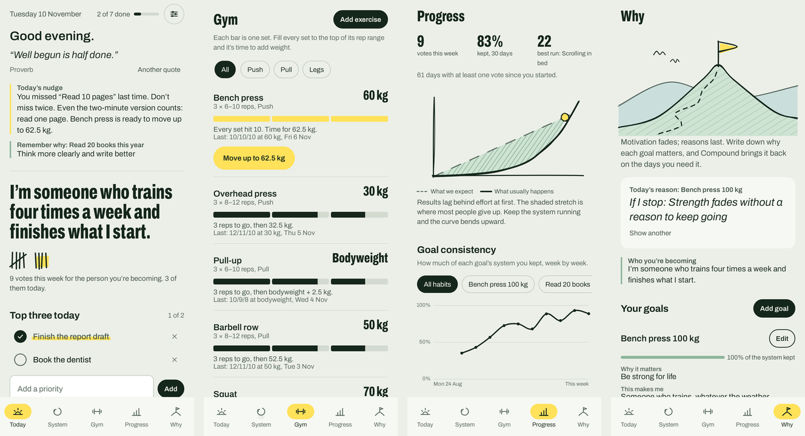

# Compound

A daily-routine and gym tracker for Android, built on one idea from *Atomic Habits*: the system you run every day matters more than the goal you set. Compound plans your day around your calendar, tracks the habits that make up your system, and tells you when it's time to put more weight on the bar.



## What it does

**Today** opens with a quote, a short nudge built from your own data ("you missed this last time, don't miss twice"), and the sentence you wrote about who you're becoming. Every habit you tick and set you log adds a tally mark, a vote for that person. Below that are your top three priorities and the day split into morning, afternoon and evening, with habits fitted into the free time around your calendar events.

**System** holds your goals and the habits that serve them. Each goal is scored on how well you kept its habits, not on the result. Habits are designed with the four laws (make it obvious, attractive, easy, satisfying), and habits you want to break use the inverted laws. A habits scorecard and a weekly review help you adjust the system.

**Gym** uses double progression. Each set gets a bar that fills as you add reps; when every set reaches the top of its rep range, Compound tells you to move up. It includes a set logger, a rest timer, history and personal bests. Workouts from a Garmin watch can tick your training habit automatically.

**Progress** charts consistency per goal over 12 weeks, a daily heatmap, votes per week, strength over time, weekly volume and training minutes.

**Why** keeps the reasons behind each goal: why it matters, who it makes you, what happens if you stop, a note to your future self, and a habit contract you can send to a friend. A daily reminder can bring one of these back.

Optional reminders: a morning quote, an evening check-in and a "remember why" notification.

## Install it on your phone

Download `app-debug.apk` from the latest run under the **Actions** tab (or from a release), open it on your phone and allow installing from that source when Android asks.

Android only updates an app if the new APK is signed with the same key as the installed one. Builds from different machines (your computer, GitHub Actions) use different debug keys, so before switching, go to **Settings > Your data > Export backup**, uninstall, install the new APK and import the backup.

## Build it yourself

You need Android Studio (or JDK 17 and the Android SDK).

1. Clone the repository and open the folder in Android Studio.
2. Let Gradle sync, then press **Run** with your phone connected (USB debugging on) or an emulator.

From the command line: `./gradlew assembleDebug`, and the APK appears in `app/build/outputs/apk/debug/`. Unit tests run with `./gradlew testDebugUnitTest`.

Every push to `main` runs the tests and builds the APK on GitHub Actions (`.github/workflows/build.yml`).

## Garmin workouts

Compound doesn't log in to Garmin. Garmin Connect can share workouts with Android's Health Connect on Android 14 and later, and Compound reads them from there.

1. In Garmin Connect, open **More > Settings > Connected apps > Health Connect** and allow it to write workouts.
2. In Compound, open **Settings > Garmin and Health Connect** and allow Compound to read exercise data.
3. Sync your watch with Garmin Connect, then tap **Sync now**.

Health Connect provides workout type, duration and timing. Individual strength sets aren't shared, so log those in the Gym tab.

## Privacy

Everything stays on the phone: habits, logs, calendar events and workouts. Compound only reads your calendar and Health Connect data; it never changes them and has no server. Use **Export backup** to move your data to a new phone.

## Project layout

```
app/src/main/java/app/compound/
  data/       saved data model, repository (DataStore + JSON), quotes, starter routine
  logic/      day planner, streaks and consistency, gym progression, daily nudge
  platform/   phone calendar, Health Connect (Garmin), reminder notifications
  ui/         Compose screens, components, charts, theme, hand-drawn illustrations
app/src/test/ unit tests for the planner, streaks and progression
```

Built with Kotlin, Jetpack Compose and Material 3, targeting Android 16 (API 36) with a minimum of Android 9 (API 28).

## Credits

The ideas come from *Atomic Habits* by James Clear; this project isn't affiliated with the author or publisher. The typeface is Archivo by Omnibus-Type, used under the SIL Open Font License (see `licenses/Archivo-OFL.txt`). Illustrations are original and drawn in code.
